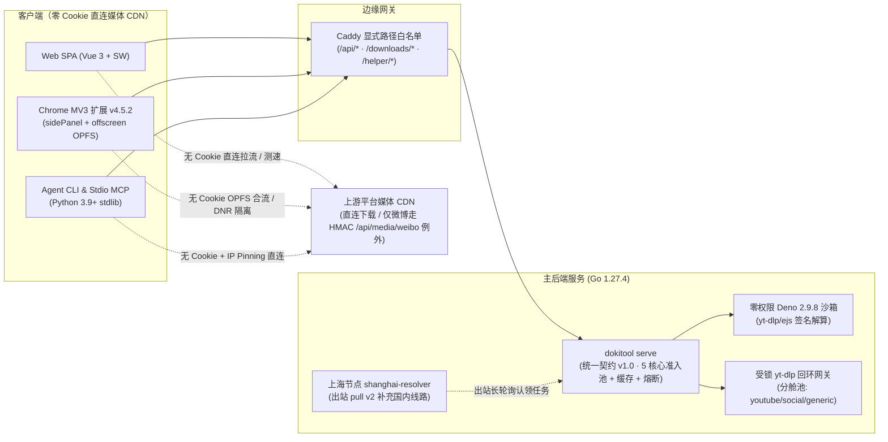

<h1 align="center">DokiTool</h1>

<p align="center">
  <strong>多平台公开媒体无水印解析 · 浏览器零 Cookie 直连下载 · Chrome MV3 侧边栏合流 · 零依赖 Agent CLI &amp; MCP</strong>
</p>

<p align="center">
  <a href="#-5-分钟快速上手"></a>
  <a href="https://snap.dokitool.com"></a>
  <a href="docs/EXTENSION.md"></a>
  <a href="tools/dokitool-agent/README.md"></a>
  <a href="docs/openapi.json"></a>
  <a href="LICENSE"></a>
</p>

<p align="center">
  
  
  
  
  
  
</p>

> [!TIP]
> **🌐 纯 Web 零安装**：访问 [**snap.dokitool.com**](https://snap.dokitool.com)，粘贴分享链接即可解析并由浏览器无 Cookie 直连上游 CDN 流式保存（基于统一媒体契约 `schema_version=1.0`）。

> [!IMPORTANT]
> **🧩 [Chrome MV3 侧边栏原生扩展 `v4.5.2`](docs/EXTENSION.md)**：免油猴直接支持 **YouTube 4K60** 与 **B 站免登录 1080P DASH** 本地 `Mediabunny` 无损合流、纯客户端 VTT/SRT 双语字幕导出、后台多 P 流式队列、运行态 `/helper/extension-version.json` 自动同步检测与宿主级可选回环授权 + 应用层单端口精确源站隔离。

> [!NOTE]
> **🤖 [零依赖 Agent CLI & Stdio MCP Server](tools/dokitool-agent/README.md)**：仅需 Python 3.9+ 标准库（零 `pip`），自带 [`SKILL.md`](tools/dokitool-agent/SKILL.md)，默认 **100% 只读** 接入 Claude Code / Cursor / Codex，内置公网 IP pinning、默认不覆盖落盘（no-clobber）与 `json3`/VTT/SRT 字幕提取。

---

## ✨ 核心亮点

- **🌐 14 个核心平台 + 1000+ Tier-2 长尾站点**：主目录覆盖抖音、快手、B 站、小红书、今日头条、微博、皮皮虾、皮皮搞笑、最右、X、YouTube、Instagram、Facebook、Tumblr；可选开启 `DOKITOOL_YTDLP_GENERIC_ENABLED` 后，未命中核心目录的合法公网链接自动走受控具名提取器隔离池（严禁盲抓 `generic`）。
- **🎬 免油猴 4K60 & B 站 1080P 无损合流**：Chrome MV3 扩展 `v4.5.2` 采用 `sidePanel` + `background` + `offscreen` OPFS 架构，本地并发拉流并用 `Mediabunny 1.65.2` 无重编码封装完整 `.mp4`，关闭侧边栏不断流，无需安装 Tampermonkey。
- **💬 纯客户端 VTT / SRT / 双语字幕导出**：侧边栏支持单轨 VTT/SRT 转换与双语主副字幕时间轴合并，Agent CLI/MCP 支持多语种轨道筛选导出与 VTT/SRT/`json3` 转换，零服务端字幕代理。
- **🚀 日本主解析 + 上海国内线路补充**：主后端与上海 `shanghai-resolver` 节点通过出站 `pull` 长轮询（`v2` 协议）协同补充抖音国内 `*.douyinvod.com` 4K 原画及可选 B 站国内线路，前端自动对多条线路并发 Range 测速择优。
- **📊 `/monitor` 只读运维大盘 + `SIGHUP` 热配置**：原生 SVG + CSS 宽屏监控大盘覆盖 9 大只读观测区块，令牌仅驻留页面内存或单标签页 `sessionStorage`；支持 `SIGHUP` 原地无损热重载多 Key 注册表与分舱/熔断策略。
- **🛡️ 供应链与契约硬门禁**：`yt-dlp` 与 `Deno` 全仓 6 处锁定文件 SHA-256 强制对账、GitHub Actions 40 位 SHA 引脚、SLSA v1 构件溯源验签、SSOT 全栈一致性门禁与 L1–L4 自动化回归。

---

## 🎯 三端能力矩阵

| 能力维度 | 🌐 纯 Web SPA（零安装） | 🧩 Chrome MV3 扩展（`v4.5.2`） | 🤖 Agent CLI & Stdio MCP |
| --- | --- | --- | --- |
| **安装与依赖** | 打开网页即用 | 解压加载 `dokitool-chrome-extension.zip`（Chrome/Edge 116+） | Python 3.9+ 标准库（零第三方 `pip` 依赖） |
| **14 核心平台 + 长尾站点** | 支持（14 核心 + 服务端开启时支持长尾） | 支持（标签页自动跟随严格限 14 核心，主动输入/右键支持长尾） | 支持（受 Key `platforms` 白名单与预算控制） |
| **YouTube HD / 4K60** | 引导安装 Chrome MV3 官方扩展（纯 Web 不内置油猴） | **内置免油猴**（`TVHTML5` + Deno 沙箱解算 + OPFS `Mediabunny` 合流） | 默认跳过（YouTube 流通常绑定出口 IP，优先走扩展） |
| **B 站 1080P DASH** | 渐进式 MP4 预览与下载 | **免登录 1080P（AVC/HEVC/AV1）+ 30280 AAC 无损合流 & 独立 M4A** | 支持渐进式直链与多 P `/api/resolve` |
| **字幕提取与双语导出** | 展示字幕附件直链 | **纯客户端 VTT / SRT / 双语合并落盘**（5 MiB 单轨上限） | **CLI/MCP 支持多语种轨道筛选与 VTT / SRT / `json3` 转换导出**（带扇出与字节上限；双语合并为扩展专属） |
| **多图 / 多 P / 历史** | 单图直存、多图 `<= 500 MiB` ZIP、SW 流式下载 | 子目录无上限流式落盘、后台多 P 队列、G6 脱敏 50 条持久化历史 | 流式 `.part` 落盘、默认 no-clobber 防覆盖、可选 `--overwrite` |
| **权限与安全边界** | 同源 `/downloads/` SW、零 Cookie 直连 CDN | 零 `<all_urls>`、零 Content Script、DNR `1004/1006–1008`、宿主级可选回环授权 + 应用层单端口精确源站隔离 | 默认 100% 只读 MCP、逐跳公网 IP pinning、严格后缀白名单 |

---

## 🏗️ 系统架构与数据流



- **浏览器/客户端直连 CDN，服务端仅解析**：Go 后端只处理输入校验、平台解析与统一契约 `schema_version=1.0` 输出；音视频与图片字节由用户端直接拉取，**微博视频（`/api/media/weibo` 30 分钟短期 HMAC 票据）是唯一的服务端流式中转例外**。
- **运行态版本单源同步**：前端与扩展共享 `frontend/src/core/extensionReleaseMeta.json` 与线上 `/helper/extension-version.json`（含 `version`、`extensionId` 与 ZIP `sha256`），长驻未刷新的 Web 页面打开下载弹窗或切回前台即可实时感知新版本并准确区分「2 步覆盖升级」与「3 步全新安装」。

---

## ⚡ 5 分钟快速上手

### 1️⃣ 纯 Web 零安装

直接打开 [**https://snap.dokitool.com**](https://snap.dokitool.com)，粘贴任意支持平台的分享口令或链接即可预览画质、切换线路并流式保存到本地。

### 2️⃣ 安装 Chrome MV3 扩展 `v4.5.2`（推荐桌面用户）

1. 下载官方预构建包：[`https://snap.dokitool.com/helper/dokitool-chrome-extension.zip`](https://snap.dokitool.com/helper/dokitool-chrome-extension.zip)（根目录直出 `manifest.json`，也可在站点顶部「Chrome 扩展」弹窗下载）；
2. 解压至本地目录，在 Chrome 打开 `chrome://extensions/` 并开启右上角 **「开发者模式」**；
3. 将解压后的目录拖入扩展页面即可加载（固定到工具栏或按 **`Alt+Shift+D`** 随时呼出侧边栏）。

> **升级旧版只需 2 步**：下载新版压缩包覆盖解压到原目录 → 在 `chrome://extensions/` 点击扩展卡片上的 **刷新** 按钮，偏好设置、主题与脱敏历史完整保留。详细构建与权限说明见 [docs/EXTENSION.md](docs/EXTENSION.md)。

### 3️⃣ AI Agent CLI & Stdio MCP Server（零 `pip` 依赖）

```bash
# 1. 列出当前实例启用平台（零凭据即可匿名验证）
python3 tools/dokitool-agent/dokitool_agent.py platforms

# 2. 解析单条分享链接（配置 DOKITOOL_API_TOKEN 走个人配额池）
export DOKITOOL_API_TOKEN='<your-token-from-secret-store>'
python3 tools/dokitool-agent/dokitool_agent.py parse 'https://www.douyin.com/video/EXAMPLE_ID'

# 3. 作为默认 100% 只读 Stdio MCP Server 接入 Claude Code / Cursor / Codex
python3 tools/dokitool-agent/mcp_server.py
```

更多子命令（`resolve`、`download`、`subtitles`、`--overwrite`、批量脚本）与 MCP 写操作显式开启参数见 [tools/dokitool-agent/README.md](tools/dokitool-agent/README.md) 与 [tools/dokitool-agent/SKILL.md](tools/dokitool-agent/SKILL.md)。

### 4️⃣ 开发者本地全栈启动（4 个标准 `Makefile` 入口）

环境要求：**Go `1.27.4`**（见 `backend/go.mod`）、**Node.js `20+`**（CI 锁定 `24`）、**Python `3.9+`**。首次克隆先执行 `cd frontend && npm ci --ignore-scripts`，之后根目录直接使用 4 个零黑魔法 `Makefile` 命令：

```bash
make dev    # 本地并行启动 Go 后端 (127.0.0.1:8081) 与 Vite 前端开发服务器
make test   # 全量回归：Go -race 单测 + 前端单测 + Python 契约 / Agent / 冒烟单测
make check  # 安全与契约总检：公开仓凭据守门 + SSOT + 供应链离线 + OpenAPI/Schema（默认强校验 jsonschema）+ typecheck + go vet
make build  # 本地构建：注入 Commit SHA 的 Go 双二进制 + 前端静态资源 + Chrome MV3 扩展 ZIP + 首屏体积预算校验（正式 Linux + SLSA 发布件由 release-build.yml 产出）
```

---

## 🌐 平台支持范围（14 核心平台 + 1000+ 长尾站点）

- **核心目录 SSOT**：`backend/config/platforms.json`（唯一内嵌 14 平台真值表，同步驱动后端路由、CLI 导出、OpenAPI 与前端平台快照）。
- **Tier-2 长尾兜底**：启用 `DOKITOOL_YTDLP_GENERIC_ENABLED=true` 后，`GET /api/parse` 在 `platform=all`（或省略）模式下可将合法公网长尾链接路由至独立 `PARSE_GENERIC` 隔离池（覆盖 Vimeo、TikTok、Reddit、SoundCloud 等 1000+ 具名提取器，严格禁用盲抓 `generic`）。

<details>
<summary><strong>点击展开：14 个核心平台链接形式、交付方式与已知限制明细表</strong></summary>

| 平台 | 支持媒体类型 | 接受的链接形式（含短链与域名归一化） | 交付方式与已知限制 |
| --- | --- | --- | --- |
| 抖音（`douyin`） | 视频 / 图片 / 实况 | `douyin.com`（`www.`、`v.`）、`iesdouyin.com` | 上海 `pull` 通道补充国内 4K 原画，不支持合集链接（`mix_id`） |
| 快手（`kuaishou`） | 视频 / 图片 | `kuaishou.com`（`/short-video/`、`/f/`、`v.`、`c.`） | 仅公开分享作品；触发上游页面风控时返回 `UPSTREAM_BLOCKED` |
| 哔哩哔哩（`bilibili`） | 视频 / 多 P | `bilibili.com`（`www.`、`m.`）、`b23.tv` | Chrome 扩展支持免登录 1080P DASH 合流与独立 M4A；多 P 按需调用 `/api/resolve`；不支持番剧/付费/大会员专享 |
| 小红书（`xiaohongshu`） | 视频 / 图片 / 实况 | `xiaohongshu.com`、`xhslink.com`、`rednote.com` | 网页直链须含 `xsec_token`，缺失时请从小红书 App 复制分享链接 |
| 今日头条（`toutiao`） | 视频 | `toutiao.com`（`www.`、`m.` 的 `/video/`、`/group/`、`/i<id>`） | `*.toutiaovod.com` 无 CORS 与附件头，Web 端通过「打开源链接」右键另存为 |
| 微博（`weibo`） | 视频 | `weibo.com`、`www.weibo.com`、`video.weibo.com/show?fid=...`、`m.weibo.cn` | 匿名网页经 `/api/media/weibo` 30 分钟 HMAC 票据中转；Bearer 通道返回直链（直连需 `Referer: https://weibo.com/`） |
| 皮皮虾（`pipixia`） | 视频 / 图片 | `pipix.com`（`h5.pipix.com/item/...`、`/ppx/item/...`） | 仅支持公开分享帖子 |
| 皮皮搞笑（`pipigx`） | 视频 | `pipigx.com`（`h5.pipigx.com/pp/post/...`）、`ippzone.com` | 优先校验 `tbvideo.ixiaochuan.cn` 无水印 MP4 直下（不支持 ZIP），失败回退手动打开 |
| 最右（`zuiyou`） | 视频 / 图片 | `izuiyou.com`、`share.xiaochuankeji.cn` | 线上关闭视频 `tbvideo` 改写，视频通过「打开源链接」手动保存；图片支持直下与打包 |
| X（`x`） | 视频 / 图片 | `x.com`、`twitter.com`（状态页、`/photo/<N>`、`/video/<N>`）、`t.co`（受控单跳） | 纯文字推文返回 `NO_MEDIA`；受限推文（`TweetTombstone`）需启用 `-x-tombstone-fallback=fxtwitter` |
| YouTube（`youtube`） | 视频 / 字幕 | `youtube.com`（`www.`、`m.`、`music.` 的 `/watch`、`/shorts/`、`/live/`、`/embed/`）、`youtu.be` | **使用 Chrome MV3 官方扩展 `v4.5.2` 本地解析、4K60 无损合流与双语字幕导出**（独立油猴脚本已归档至 `archive/youtube-userscript-final`） |
| Instagram（`instagram`） | 视频 / 图片 | `instagram.com`（`www.`、`m.`）、`instagr.am`（`/p/`、`/reel/`、`/reels/`、`/tv/`） | 不支持 Stories（`/stories/`）及私密/需登录帖（返回 `UPSTREAM_BLOCKED`） |
| Facebook（`facebook`） | 视频 | `facebook.com`、`www.`、`m.`、`fb.watch` | `fb.watch` 短链需登录展开，接口提示先在浏览器打开并复制完整链接；受限视频返回 `UPSTREAM_BLOCKED` |
| Tumblr（`tumblr`） | 视频 | `tumblr.com`、`www.tumblr.com`、`*.tumblr.com` | 仅支持公开视频帖（单帖最多提取 4 个视频条目） |

</details>

---

## 📊 监控大盘与运维热配置

- **宽屏只读监控面板（`/monitor`）**：纯原生 SVG + CSS 渲染（零第三方图表库、严格 `noindex`、零写入端点），需携带 `owner` 角色 Bearer Token 查询 `GET /api/stats`；令牌仅存页面内存或可选单标签页 `sessionStorage`（绝不写入 `localStorage` / Cookie / URL 参数）。集中展示核心指标卡、11 项脱敏运行开关、准入与 `yt-dlp` 分舱水位、14 平台熔断器状态、近 30 天日趋势 / 近 24 小时时趋势、平台健康度排行与多 Key 统计表。
- **`SIGHUP` 无损热重载**：配置 `DOKITOOL_API_KEYS_FILE` 或 `DOKITOOL_RUNTIME_CONFIG_FILE` 后，执行 `kill -HUP <PID>` 或 `systemctl reload dokitool-go` 即可原地热更新多角色密钥、分舱并发、单平台熔断与 `disabled_platforms` 秒级止血策略，新配置校验失败自动回退保留原内存策略。

<details>
<summary><strong>点击展开：多池准入与限流分舱规则速查</strong></summary>

服务端按可信客户端 IPv4 或 IPv6 `/64` 前缀隔离匿名预算（另保留微博流中转 `DOKITOOL_WEIBO_` 与下载上报 `DOKITOOL_REPORT_` 辅助池；完整参数见 [docs/CONFIGURATION.md](docs/CONFIGURATION.md)）：

| 准入池 | 环境变量前缀 | 覆盖请求范围与分流规则 |
| --- | --- | --- |
| `fast` | `DOKITOOL_PARSE_` | 未命中缓存的纯 Go 国内平台 `GET /api/parse`（含热配置单平台舱壁 `fast_per_platform_max_concurrency`）及已退役旧路径 |
| `resolve` | `DOKITOOL_RESOLVE_` | 未命中缓存的纯 Go 平台按需分集解析 `GET /api/resolve`（如 B 站多 P），拥有更宽的独立单 IP 突发与并发配额 |
| `slow` | `DOKITOOL_PARSE_SLOW_` | 未命中缓存的海外慢解析平台（`x`、`youtube`、`instagram`、`facebook`、`tumblr`）及未命中缓存的 YouTube EJS 助手端点 |
| `generic_slow` | `DOKITOOL_PARSE_GENERIC_` | 启用 `DOKITOOL_YTDLP_GENERIC_ENABLED` 时，第二级长尾具名提取器兜底使用的独立隔离准入池与子进程槽位 |
| `catalog` | `DOKITOOL_CATALOG_` | `GET /api/platforms`、命中缓存的 `GET /api/youtube/context`，以及命中进程内新鲜缓存的匿名 `GET /api/parse` / `GET /api/resolve` |
| `owner` / 多 Key | `DOKITOOL_OWNER_*` / `DOKITOOL_API_KEYS_FILE` | 按密钥独立并发池、慢解析子并发上限与零槽位新鲜缓存快路径；无效鉴权头扣减来源 IP 防刷配额并返回 `401` / `429`，绝不静默降级 |

</details>

---

## 🛡️ 安全与隐私红线

- **零 Cookie 与逐跳防 SSRF**：服务端与三端客户端均不采集或转发平台账号 Cookie；所有服务端出站请求及 `tools/dokitool-agent` / 示例批量下载器均执行逐跳重定向重验、禁止 `https -> http` 降级、禁止非标准端口与公网 IP 绑定拨号（拦截回环、私网、链路本地与云元数据地址）。
- **零服务端媒体中转**：音视频、图片与字幕字节由用户端直连拉取；仅匿名网页访客的微博视频例外，使用 30 分钟短期 HMAC-SHA256 签名票据且受慢写超时与响应类型校验保护。
- **Chrome MV3 最小权限隔离**：零 `content_scripts`、零 `<all_urls>`、零 `cookies` 权限；DNR 规则（含 B 站国内 Rule `1004` 与海外 Akamai UPOS 窄匹配 Rule `1006–1008`）严格限定 `initiatorDomains: [chrome.runtime.id]`；本机调试回环地址采用宿主级可选回环授权 + 应用层单端口精确源站隔离并在切换源站时自动回收；被动落盘执行严格安全后缀白名单。
- **Agent 与运维脚本边界**：`tools/dokitool-agent` 默认只读 MCP、下载默认 `overwrite=False`（原子 `os.link` 防静默覆盖）、字幕与多轨解析带深度/字节/墙钟上限；阶段二无头验收工具 `stage2_browser.mjs` 强制 `--headless=new`、`--remote-debugging-pipe` 私有管道与 Fail-Closed 脱敏扫描。
- **供应链与生产治理**：`yt-dlp` 与 `Deno` 全仓 6 处锁定文件 SHA-256 强门禁、GitHub Actions 40 位 commit SHA 引脚、npm SRI 禁弱 `sha1-`、`.github/workflows/release-build.yml` 静态 `CGO_ENABLED=0` + SLSA v1 构件溯源；**合入 `main` 不自动上线，一切生产变更仅通过发布 Issue 执行**。

---

## 🧪 L1–L4 自动化回归与仓库结构

| 层级 | 覆盖范围 | 核心入口 |
| --- | --- | --- |
| **L1 离线契约 & 单测** | Go `-race` 全量包单测、统一 Schema v1、OpenAPI 3.1.0、6 文件运行时锁、SSOT 6 项一致性门禁、供应链离线审计、前端全量单测 & 首屏体积预算 | `make test` · `make check` · `.github/workflows/ci.yml` |
| **L2 无头浏览器 E2E** | 真实 `--headless=new` Chrome（`--remote-debugging-pipe`）加载扩展与 SW：水合、主题、桥接握手、OPFS 合流、文件名冲突对抗、零残余进程 `RESIDUAL_CHROME=0` | `scripts/test-extension-e2e.mjs` · `scripts/test-download-browser.mjs` · `scripts/prod-smoke/test_stage2_browser.mjs` |
| **L3 定时线上巡检** | 每日 `yt-dlp` / `Deno` 正式版监控（`upstream-watch.yml`）+ 每 12 小时零权限 Deno/EJS `tv`+`main` 变体与只读接口低噪 Canary（`upstream-canary.yml`） | `scripts/check-upstream-updates.py` · `scripts/check-upstream-canary.py` |
| **L4 发布后生产验收** | 阶段一服务端/静态全量 SHA-256 + 14 平台 API 冒烟（`smoke.py`）+ 阶段二零修改官方扩展无头 Chrome 复测（`stage2_browser.mjs`） | `scripts/prod-smoke/smoke.py` · `scripts/prod-smoke/stage2_browser.mjs` · [docs/RELEASE-RECEIPT.md](docs/RELEASE-RECEIPT.md) |

<details>
<summary><strong>点击展开：仓库目录结构</strong></summary>

```text
.
├── backend/
│   ├── cmd/
│   │   ├── dokitool/          # 主后端 HTTP API 服务（serve）与 catalog / hash-token / validate / version 子命令
│   │   ├── shanghai-resolver/ # 上海国内线路辅助解析进程（出站 pull v2 模式）
│   │   ├── genstatstypes/     # 从 Go 类型与常量生成 frontend/src/monitor/statsTypes.generated.ts（SSOT）
│   │   └── loadtest/          # 仅限本机回环（127.0.0.1）运行的混合流量压测工具
│   ├── config/                # 内嵌平台注册目录唯一真值（platforms.json）
│   └── internal/              # fetch、urlpolicy、bearer、unified、catalog、probe、ytengine、platform/*、media/*、shresolver、api
├── frontend/                  # Vue 3 + Vite SPA（dokitool-web）、/monitor 大盘、SW 流式下载器与 Chrome MV3 扩展源码
├── tools/dokitool-agent/      # 零第三方依赖 Python 3.9+ CLI、默认只读 Stdio MCP Server、SKILL.md 与安全回归测试
├── ops/                       # Caddy 反向代理脱敏示例、运行时/多 Key 配置示例与发布/回滚脚本（ops/release/）
├── scripts/                   # 公开仓凭据守门、SSOT 一致性门禁、供应链审计、运行时锁同步、OpenAPI 校验、生产冒烟（prod-smoke/）与 L2 浏览器测试
├── docs/                      # 接口契约、配置、扩展、下载、发布回执、上游监控、Agent 指南与历史归档文档
├── examples/                  # 独立 Python 3.9+ 标准库个人 Agent 批量直连下载参考脚本
└── Makefile                   # 本地开发、测试、安全契约检查与本地构建统一入口（dev / test / check / build）
```

</details>

---

## 📚 文档导航

| 文档 | 内容摘要 |
| --- | --- |
| [docs/API.md](docs/API.md) · [docs/openapi.json](docs/openapi.json) | 统一媒体 v1（`schema_version=1.0`）接口契约、错误码、YouTube 助手接口与 OpenAPI `3.1.0` 规范 |
| [docs/EXTENSION.md](docs/EXTENSION.md) | Chrome MV3 原生侧边栏扩展 `v4.5.2` 安装、源码构建、凭据配置与安全边界 |
| [tools/dokitool-agent/README.md](tools/dokitool-agent/README.md) · [SKILL.md](tools/dokitool-agent/SKILL.md) | 零依赖 Python Agent CLI 与默认只读 Stdio MCP Server 使用与集成规范 |
| [docs/AGENT-API.md](docs/AGENT-API.md) · [docs/AGENT-BATCH-DOWNLOAD.md](docs/AGENT-BATCH-DOWNLOAD.md) | 个人 Agent 通道鉴权、多角色配额、批量直连下载流水线与断点续传实践 |
| [docs/CONFIGURATION.md](docs/CONFIGURATION.md) | `dokitool` 与 `shanghai-resolver` 启动参数、环境变量、多 Key 与 `SIGHUP` 热配置全量参考 |
| [docs/DOWNLOADS.md](docs/DOWNLOADS.md) | 浏览器流式 SW 下载、多线路 Range 测速、ZIP 上限与历史下载验收记录 |
| [docs/DEPLOYMENT.md](docs/DEPLOYMENT.md) · [docs/RELEASE-RECEIPT.md](docs/RELEASE-RECEIPT.md) | 生产发布受控闭环、阶段一/二脱敏回执模板与原子回滚说明 |
| [docs/UPSTREAM-WATCH.md](docs/UPSTREAM-WATCH.md) · [docs/UPSTREAM-CANARY.md](docs/UPSTREAM-CANARY.md) | `yt-dlp` / `Deno` 6 文件锁同步、每日版本巡检与 12 小时低噪 Canary 探针 |
| [docs/HISTORY.md](docs/HISTORY.md) | Go 迁移历程、早期架构记录与永久归档快照索引（`archive/php-oracle-final`、`archive/youtube-userscript-final`） |

---

## ⚖️ 许可证与上游致谢

本仓库原创与衍生代码采用 [MIT License](LICENSE)，完整第三方组件与许可证声明见 [NOTICE](NOTICE)：

- **早期架构与解析参考**：[jiuhunwl/short_videos](https://github.com/jiuhunwl/short_videos)（MIT）与 [jiuhunwl/shortvideo-html](https://github.com/jiuhunwl/shortvideo-html)（MIT）— 详见 [NOTICE](NOTICE) 与 [docs/HISTORY.md](docs/HISTORY.md)。
- **Mediabunny**（`1.65.2`，`MPL-2.0`，Vanilagy）：作为未修改上游库内嵌于 Chrome MV3 扩展的 `offscreen` 打包产物（`dokitool-chrome-extension.zip`）中，用于在浏览器本地对 YouTube 分离轨与 B 站 DASH 音视频执行无损封装；完整 MPL-2.0 文本保留在 `frontend/public/licenses/mediabunny-MPL-2.0.txt` 与 [NOTICE](NOTICE)。
- **FixTweet**（`api.fxtwitter.com`）：在服务端显式启用 `-x-tombstone-fallback=fxtwitter` 时，作为 X 受限推文（`TweetTombstone`）的可选公开 HTTP 元数据查询源；本仓库未复制或分发 FixTweet 源代码（详见 [NOTICE](NOTICE)）。
