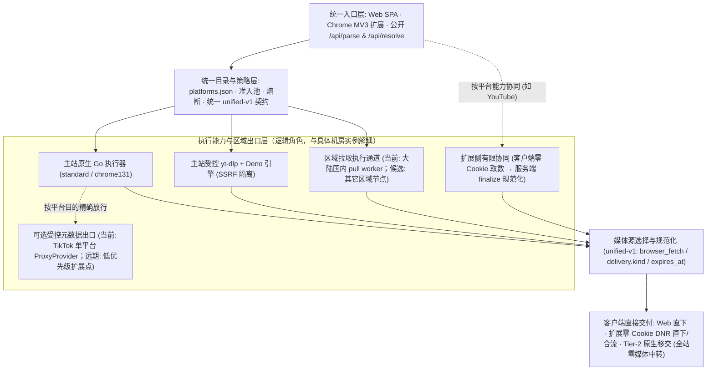
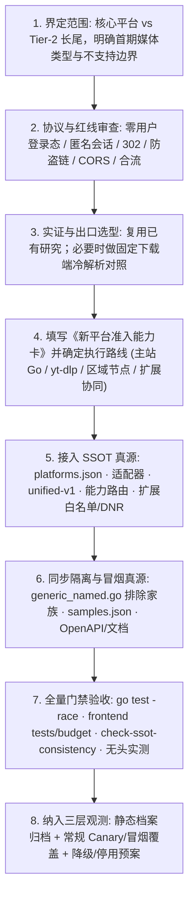

# 多平台能力架构、执行路由与新平台准入规范

本文档定义 DokiTool 的多平台长期架构基线、六维解耦模型、16 核心平台与 Tier-2 静态能力档案、三层平台观测体系，以及未来新增平台的统一准入流程与能力卡规范。

> **文档边界说明**：
> - 本文档既沉淀**当前已实现基线（`v4.6.0`）**，也明确保留**远期可演进方向**（如多区域拉取节点、可选网络出口与定期跨出口观测）。
> - 远期备选方向不自动构成当前开发任务，也不会因暂不实施而从长期架构规划中删除；任何进入实施阶段的新增能力均须通过独立证据验证与决策后推进。

---

## 一、六维架构模型（解耦协议、执行、地域、出口、源选择与交付）

不同平台的上游协议、反爬风控、地域分发与防盗链机制天然各异，架构目标**不是强行将所有平台统一为同一种解析实现**，而是**统一接入规则、能力表达、执行路由边界与验收契约**。

为避免架构过度绑定于当前单一部署实例，系统将每条媒体链路显式拆解为六个正交维度：

| 维度 | 核心问题 | 典型形态（逻辑角色，非硬编码机房名） | 不可混淆的边界 |
| --- | --- | --- | --- |
| **1. 平台协议与会话（Platform Protocol）** | 上游需要怎样的请求链与匿名态？ | 零 Cookie 公开 JSON/HTML、单次即弃匿名访客票据（如头条 `ttwid`）、内存短时匿名访客会话（如微博 `SUB/SUBP`）、302 重定向链、`yt-dlp` / Deno EJS 签名解算 | **服务端自建匿名访客票据 ≠ 窃取用户浏览器登录态**；协议是否需要 `Set-Cookie`/受控 302 决定了它能否在 MV3 浏览器沙箱内运行 |
| **2. 执行能力形态（Execution Capability）** | 哪套引擎执行取数与规范化？ | 主站原生 Go 适配器（`fast` 池）、主站 `yt-dlp` 受控引擎（`slow` / `generic_slow` 池）、区域拉取 worker、浏览器扩展有限协同（客户端取数 + 服务端 `finalize`） | 取数位置不等于解析代码必须双端复制；优先保持单一规范化真源（`unified-v1`） |
| **3. 地理区域角色（Geographic Region）** | 请求从哪类逻辑区域发出？ | 公网统一入口所在区域（当前部署为海外主站）、大陆国内取源区域（当前为上海 `pull` 节点）、以及未来按需接入的候选区域（如香港、首尔等） | 逻辑区域角色与具体服务器地名解耦；迁移主站位置与增删内部执行节点属于两类独立运维情景 |
| **4. 网络出口机制（Network Egress）** | 出站流量如何到达平台上游？ | 本机直连（标准或 `chrome131` TLS 传输层）、出站长轮询内部节点（无公网入站端口）、单平台受控元数据代理（`ProxyProvider`）、未来低优先级可选出口池 | 代理仅允许用于受控元数据页/短链，严禁承载媒体流；`ytengine` 在启用 SSRF 目标策略时禁配通用代理 |
| **5. 媒体源选择与增强（Media Source Selection）** | 如何组织多条候选 CDN 与画质？ | 主站直出、主站与区域节点并行竞速合并（失败自动回退并缩短缓存 TTL）、无签名国内 CDN 镜像确定性前置（如小红书 `xhscdn.com`） | 区域节点属于“增强/优选层”还是“强依赖单点”须显式标注，不把上游未返回的清晰度误判为代码缺陷 |
| **6. 客户端交付（Client Delivery）** | 最终如何把媒体安全落盘？ | Web 直下（`browser_fetch: "allowed"`）、扩展白名单零 Cookie DNR 直下（`browser_fetch: "blocked"` 或无 CORS 批量）、扩展 Offscreen OPFS 无损合流（`delivery.kind: "mux"`）、Tier-2 非白名单原生下载移交（`chrome.downloads`） | **下载依赖扩展 ≠ 解析也应迁至扩展**；下载决策细化到单条 `source` 与操作级（单项 / 批量 / ZIP / 合流） |

### 信息四分层原则（避免单表混淆）

系统严禁把下列四类正交信息揉成单一的“支持 / 不支持”布尔标签：

1. **平台固有实现能力**：支持哪些媒体类型（`platforms.json` 的 `capabilities` 仅表达内容类型，不混入执行环境）、支持哪些解析路径。
2. **当前实例部署绑定**：哪些可选开关（如 `DOKITOOL_YTDLP_ENABLED`、`DOKITOOL_SHANGHAI_BILIBILI`、`DOKITOOL_BILIBILI_DASH`、`DOKITOOL_YOUTUBE_HELPER`、`DOKITOOL_YTDLP_GENERIC_ENABLED`）在当前实例处于开启状态。
3. **动态运行反馈**：上游风控、样本有效性、熔断器状态与当前出口可达性（属于可变化观测数据，不写死进静态目录）。
4. **单条结果交付条件**：响应内每条 `variant`/`source` 携带的 `delivery.kind`、`source.browser_fetch`、`expires_at`，由客户端能力中心 `frontend/src/core/capabilityHub.ts` 按数据特征决策，避免在下载链路散落平台名硬编码。

---

## 二、不可突破的安全与合规红线（区分规范硬约束与项目门禁）

| 约束项 | 性质 | 精确边界说明 |
| --- | --- | --- |
| **零服务端媒体中转** | 项目核心红线 | 自 `v4.6.0` 彻底移除 `/api/media/weibo` 后，服务端不代理任何完整媒体下载流；仅保留受控的容器头/体积有限 Range 探测（`probe.go` 上限 `1 MiB`、前缀 `64 KiB`、`<= 12` 请求）。 |
| **绝不借用用户浏览器登录态** | 项目核心红线 | 扩展禁止申请 `cookies` 权限，全部 16 核心平台白名单下载与协同请求在 `offscreen` 内强制 `credentials: "omit"` 并由隔离 DNR 规则剥离 `Cookie`/`Origin`。服务端独立内存匿名访客票据（微博 `SUB/SUBP`、头条即弃 `ttwid`）仅由服务端匿名生成，与用户账号完全隔离。 |
| **Tier-2 非白名单原生移交边界** | 权限权衡边界 | 为坚持不申请 `<all_urls>`，不在 16 核心平台白名单内的 Tier-2 长尾渐进式单文件直链交由 `chrome.downloads.download` 原生下载（扩展不代理请求、不读响应体；原生 HTTP(S) 下载遵循 Chrome 自身下载会话行为）。 |
| **扩展最小显式权限与白名单隔离** | 商店规范 + 构建门禁 | `frontend/scripts/build-extension.mjs` 强制锁死 7 项权限并禁用 `cookies`/`webRequest`/`webRequestBlocking`/`scripting`/`debugger`/全局 `declarativeNetRequest`/`<all_urls>`/`content_scripts`。**演进规则**：未来若为客户端解析新增页面主域权限，必须将其与媒体下载白名单（`isWhitelistedMediaUrl`）物理拆分，防止解析域污染媒体直下白名单。 |
| **MV3 静态合规（无远程代码执行）** | 浏览器与商店硬约束 | 禁止 `eval`、`new Function` 与拉取远程 JS 执行；若需降低平台改版发版频率，优先采用「客户端取数 → 服务端 `finalize` 规范化」协同架构，避免双端维护完整解析器。 |
| **浏览器 Fetch 沙箱限制** | WHATWG Fetch 规范硬约束 | ① `fetch(..., { redirect: "manual" })` 跨源返回 `opaqueredirect`，JS 不可读 `Location`；② `Set-Cookie` 为 forbidden response-header，扩展零 Cookie `fetch` 无法构建类似 Go 的隔离匿名 `CookieJar`（这是微博不宜迁入零 Cookie 扩展解析的底层原因）；③ 扩展 `fetch()` 固定发送 `Sec-Fetch-Mode: cors`/`Sec-Fetch-Dest: empty`，无法伪造浏览器顶级导航头。 |

---

## 三、静态能力档案：16 核心平台 + Tier-2 基线（`v4.6.0`）

唯一目录真值表：`backend/config/platforms.json`（11 默认 + 5 `optional` = 16 核心平台）；准入分池真值：`backend/internal/api/platform_traits.go`。

| 平台 ID | 目录级别 / 池 | 解析引擎与协议路径 | 会话 / 出口 / 传输 | 媒体源增强与交付边界 | 备注与当前约束 |
| --- | --- | --- | --- | --- | --- |
| `douyin` | 默认 / `fast` | Go 原生；主站展短链 → 并行国内 `ResolveWork` 与主站 `fetchDetail`；图文/实况主动取消国内调用 | 零 Cookie；MP4 有限 Range 探测 `<= 1 MiB` | `direct` + `browser_fetch: "allowed"`（排除 302 调度器）；国内通道失败回退主站并缩短缓存 TTL 至 `15s` | 需国内出口获取大陆高速无水印源 |
| `bilibili` | 默认 / `fast` | Go 原生；主站展 `b23.tv` + `view` 选 `cid` → 并行国内 `playurl` 与主站 `playurl`（+可选 DASH）；多 P 按需走 `GET /api/resolve` | 零 Cookie；主站清晰度权威 | 仅 `https://*.bilivideo.com` 标 `allowed`；1080P+ DASH `mux` 由扩展 Offscreen OPFS 合流（DNR `1004` + Akamai 窄规则 `1006–1008`） | `DOKITOOL_SHANGHAI_BILIBILI` / `DOKITOOL_BILIBILI_DASH` 由部署开关控制 |
| `xiaohongshu` | 默认 / `fast` | Go 原生；支持 `-xhs-page-transport=standard\|chrome131` | 零 Cookie；对 TLS 指纹敏感 | `PreparePublic` 对无签名 `rednotecdn.com` 确定性前置国内 `xhscdn.com` 镜像；`allowed` | 网页直链需含 `xsec_token` |
| `kuaishou` | 默认 / `fast` | Go 原生；桌面短链与 `m.gifshow.com` 预重写至 `c.kuaishou.com` | 零 Cookie | 已验证 HTTPS `allowed` | 仅公开分享作品 |
| `toutiao` | 默认 / `fast` | Go 原生 | 单次请求注册即弃匿名 `ttwid` | `*.toutiaovod.com` 无 CORS/附件头，Web 直开另存、扩展直下 | 仅视频 |
| `weibo` | 默认 / `fast` | Go 原生；`/tv/show` 主走 `POST /tv/api/component` + 可选 `ajax/statuses/show` | 服务端内存 10 分钟 `visitorCookieCache` 持有匿名 `SUB/SUBP` | 全角色统一 `https://*.weibocdn.com` + `browser_fetch: "blocked"`（扩展 DNR `1003`）；Web 屏蔽 `*.sinaimg.cn` 防 ORB | 仅视频；`AGENT-API.md` 排除在 Agent 主批量外；受 Fetch 禁读 `Set-Cookie` 约束不适合零 Cookie 扩展解析 |
| `pipixia` | 默认 / `fast` | Go 原生（视频/图片） | 零 Cookie | 已验证 HTTPS `allowed` | 仅公开分享帖 |
| `pipigx` | 默认 / `fast` | Go 原生（单 POST，仅视频） | 零 Cookie | 可选 `tbvideo` 改写，不打包 ZIP | 仅视频 |
| `zuiyou` | 默认 / `fast` | Go 原生（视频/图片）；`PreparePublic` 升 HTTPS | 零 Cookie | 图片 `allowed`；视频可选 `tbvideo` 或新标签页保存 | 仅公开分享帖 |
| `pinterest` | 默认 / `fast` | Go 原生；`pin.it` `<= 3` 跳 + 免鉴权 `PinResource/get/` | 零 Cookie | `*.pinimg.com` 无 CORS：Web 单项可播放/保存、禁网页打包 ZIP，扩展逐项直下 | 静图、MP4 视频、Story Pin（HLS-only 保留告警） |
| `tiktok` | 默认 / `fast` | Go 原生；短链（5 域白名单 + 1h LRU）→ 水合页（`<= 4 MiB`）→ Photo 零 302 / Video `play302`（`<= 4` 档、禁 `Range`） | 零 Cookie；可选单代理 `DOKITOOL_TIKTOK_PROXY_URL`（仅 `tiktok-page`/`tiktok-shortlink`）+ `-tiktok-page-transport` + 无代理 6 RPM 护栏 | 图/封面/配乐 `allowed`；视频 `blocked`（扩展 DNR `1009`，拒 `webapp-prime`/`tt_chain_token`） | 云机房直连易触发 `SlardarWAF`（`403 UPSTREAM_BLOCKED`）；扩展驱动解析已列为重点实证评估方向 |
| `x` | 可选 / `slow` | Stage 1 官方免登录 Syndication → Stage 2 `yt-dlp`（5 提取器）→ 可选 `-x-tombstone-fallback=fxtwitter`（默认 `off`） | 零 Cookie；`t.co` 受控单跳 | `*.twimg.com` 直链，Web/扩展均可 | 纯文推文返回 `NO_MEDIA` |
| `youtube` | 可选 / `slow` + `ejs` | **扩展有限协同主路**：3 路并发预取（`/api/youtube/context` + `sw.js_data` + `oembed`）→ 零 Cookie `TVHTML5` `player`（DNR `1001`）→ `POST /api/youtube/finalize`（服务端无权限 Deno+EJS 解算，不入缓存）；`DOKITOOL_YTDLP_YOUTUBE_ENABLED` 默认 `false` | 零 Cookie；DNR `1001/1002` | 分离高画质扩展 OPFS 本地合流；纯客户端 VTT/SRT/双语字幕 | 生产标准配置下外部直调 `GET /api/parse` 返回 `503 SERVICE_NOT_CONFIGURED`，已明确作为扩展优先协同范例 |
| `instagram` | 可选 / `slow` | 3 级引擎：`yt-dlp` + 零 Cookie 原生 Embed（非 Reel 并发补图集）+ 零 Cookie 原生 GraphQL | 零 Cookie | `*.cdninstagram.com` / `*.fbcdn.net`（含 DASH `mux`） | Stories 与私密帖返回 `UPSTREAM_BLOCKED` |
| `facebook` | 可选 / `slow` | `ytgeneric` 表驱动（`facebook` / `facebook:reel`） | 零 Cookie；仅 `www.facebook.com` | `*.fbcdn.net` MP4 | `fb.watch` 提示浏览器展开 |
| `tumblr` | 可选 / `slow` | `ytgeneric` 表驱动（`Tumblr`，单帖 `<= 4` 视频） | 零 Cookie | `*.media.tumblr.com` MP4 | 仅公开视频帖 |
| **Tier-2（`ytdlp_generic`）** | 可选 / `generic_slow` | `generic_named.go`：`--use-extractors default,-generic,-<core16>...`；仅 `GET /api/parse` 且 `platform=all`/省略，并发 `2`，缓存 `<= 60s`，不进 `/api/platforms` | 零 Cookie；公网 DNS 防 SSRF；禁 `--impersonate`；仅音视频 | 非白名单 `direct_file` 交原生 `chrome.downloads`；非白名单 HLS/合流/ZIP 拒代理给外链 | 非对外 SLA；代表样本 `vimeo`/`reddit`/`soundcloud`；严格排除全部 16 核心平台及子提取器 |

---

## 四、三层平台观测与验证体系

主动探测、统计展示与受控实验严格解耦，划分为三个层次：

| 观测层次 | 定位与职责 | 当前承载机制 | 边界与未来扩展方向 |
| --- | --- | --- | --- |
| **Layer 1：静态能力档案** | 记录相对稳定的平台协议、执行路径、支持媒体类型、交付条件与已知限制 | `backend/config/platforms.json` + 本文档（`docs/PLATFORM-ARCHITECTURE.md`）+ 仓库 SSOT 单测 | **不把每日瞬时探测值或测速数字写进静态文档**；任何核心平台增删必须同步更新目录与测试 |
| **Layer 2：常规可用性巡检** | 低噪发现线上核心契约退化、上游 Canary 漂移与关键路径故障 | ① **被动只读展示**：`/monitor` 与 `GET /api/stats` 严格保持 100% 只读被动统计（无定时器、无探测库、无写接口）； ② **外置定时巡检**：GitHub Actions 每 12h 运行 `.github/workflows/upstream-canary.yml`（Deno/EJS YouTube Canary + `smoke.py --only platforms,youtube_context,api_boundary`，连续 2 次失败防抖建单）； ③ **发版/按需巡检**：`scripts/prod-smoke/smoke.py`（`>= 8s` 自限速、`SAMPLE_STALE` 隔离、区分目录契约 / 部署服务端开关 / 已知出口受限、零凭据脱敏）与 `stage2_browser.mjs` | 可按需在 Actions 增加低频（如每周 1 次）只读 `smoke.py` 核心平台解析冒烟；绝不在主后端进程内嵌定时探针或复杂持久化数据库 |
| **Layer 3：跨地域受控对照实验** | 评估新增/调整区域出口、客户端协同或代理策略的真实业务收益 | 按需执行的脱敏受控实验（如微博东京 vs 国内出口对照、TikTok 扩展解析实证） | **实验铁律**：严格拆分「解析出口」与「下载网络」（同一固定代表性下载端 + 冷解析绕开缓存 + 同等画质），综合评估**画质上限、解析成功率、媒体可用性、下载速率与维护成本**（不设单一教条倍数门槛）。**架构保留远期扩展空间**：未来若确有必要，可在外置任务层引入低频定期跨出口对照并输出脱敏摘要，继续与 `/monitor` 保持解耦 |

---

## 五、远期演进方向与当前实证边界（不自动转为开发任务）

1. **多区域执行节点演进（暂不实施，保留架构方向）**：
   - 现状：`backend/internal/shresolver/pull_broker.go` 当前为单池实现（`pullWaiter` 无区域维度，`waiterMatchesTask` 仅显式校验 `TaskBilibili` 而未校验 `TaskDouyin`），仅支持同区域同职责 worker 水平扩容，尚不能纯配置接入香港、首尔等异地域节点。
   - 演进方向：未来若需在保留统一公开入口的前提下接入香港、首尔等区域内部执行节点，需引入区域隔离路由与双向精确任务能力匹配（例如按 `zone` 拆分独立 `PullBroker` 池或演进为 `zone + task_type` 路由，作为**候选架构方案**，实施前再按实际平台需求定型，不提前锁死为唯一最终实现）。主站实例迁移与增删内部执行节点彼此独立。
2. **可选受控出口 / 代理池（低优先级，暂不采购与建设）**：
   - 现状：仓库仅保留单平台极薄 `ProxyProvider` 抽象（`DOKITOOL_TIKTOK_PROXY_URL`，严格限定 `tiktok-page`/`tiktok-shortlink`，不覆盖 `tiktok-play-302` 与任何媒体流）；`ytengine` 在启用 SSRF 目标策略时无条件禁止代理。
   - 演进方向：付费代理池维持低优先级，仅当实证确认存在高价值不可替代缺口且成本/合规边界成立时再评估。
3. **当前处于实证验证阶段的专项方向**：
   - **TikTok 扩展驱动解析**：认可扩展驱动解析的产品方向，但先通过真实无头 Chrome MV3 扩展实测（`Sec-Fetch-*` 头下 WAF 通过率、`/aweme/v1/play/` 覆盖率与跨出口 302 放行表现），再凭证据决定协同边界（如客户端水合后 `POST /api/tiktok/finalize` 或附加客户端 302 展开）；保留现有服务端解析能力，不提前锁死具体端点与实现。
   - **微博国内出口评估**：通过小规模固定下载端冷解析对照，综合评估画质、成功率、可用性、下载速率与维护成本后再决定是否变更，不因大陆平台身份自动迁往上海。

---

## 六、新平台统一准入流程、能力卡与 SSOT 一致性规范

### 6.1 统一准入流程

### 6.2 新平台准入能力卡（Capability Card 模板）

每次计划新增或升级核心平台时，须在设计文档或 PR 描述中完整填写以下 6 项，避免引入一次性特例：

| 栏目 | 必须明确的内容 |
| --- | --- |
| **1. 身份与范围** | 平台 ID、归属层级（核心 `fast`/`slow` 或暂留 Tier-2）、支持链接形态（含短链）、支持媒体类型（`video`/`image`/`live_photo`/`multipart` 等）与明确不支持场景 |
| **2. 协议与红线核验** | 上游接口链（原生 Go / `yt-dlp` / 扩展协同）、是否完全零用户登录态、是否需服务端匿名访客票据或受控 302、输入/出站 SSRF 白名单规则 |
| **3. 执行路径与出口** | 默认解析路径、是否需要区域节点增强或客户端协同、失败回退与缓存策略（含是否需熔断与单平台限流护栏） |
| **4. 交付与客户端契约** | `delivery.kind` 与 `source.browser_fetch` 判定规则、是否需要新增扩展媒体 CDN 白名单与独立 DNR 规则、Web 无扩展 / 扩展 / Agent API 三端表现与引导提示 |
| **5. SSOT 同步清单** | `platforms.json`、`platform_traits.go`、`generic_named.go`（排除家族）、`samples.json`、`hostWhitelist.ts`、`urlMatcher.ts`、`dnrRules.ts`、`docs/openapi.json`、`docs/PLATFORM-ARCHITECTURE.md` |
| **6. 验收与退化预案** | 离线夹具单测、真实公开样本无头验收记录、失败错误码归类（`UPSTREAM_BLOCKED` / `CONTENT_UNAVAILABLE` / `NO_MEDIA`）、上游改版时的熔断或降级/停用路径 |

### 6.3 自动化 SSOT 一致性守门清单

为杜绝新增平台漏改外围文件，以下同步关系已固化至自动化门禁（`make check` / `make test`）：

1. **`backend/config/platforms.json` ↔ `backend/internal/platform/ytgeneric/generic_named.go`**：`TestGenericExcludesAllCoreCatalogPlatforms`（Go 单测）与 `scripts/check-ssot-consistency.py` 双向断言全部核心平台均已在 `GenericExtractorArgs()`、`blockedCoreExtractorFamilies` 与 `blockedNormalizedPlatforms` 中排除，防止核心平台或其子提取器绕过 Tier-2。
2. **`backend/config/platforms.json` ↔ `scripts/prod-smoke/samples.json`**：`scripts/prod-smoke/test_smoke.py` 与 `scripts/check-ssot-consistency.py` 双向断言 `expected_platforms` 与 `platforms` 样本键与核心目录 100% 对齐，防止 12 小时 Canary 因目录变更误报。
3. **`backend/config/platforms.json` ↔ 前端目录快照 & 扩展匹配器**：`frontend/tests/platform-catalog-parity.test.mjs` 与 `scripts/check-openapi.py` 持续校验目录、OpenAPI 契约与 Caddy 路由白名单一致。
4. **公开文档脱敏**：`scripts/check-ssot-consistency.py` 与 `scripts/check-public-files.py --staged` 扫描全部 `docs/**/*.md`、`README.md` 与 `llms.txt`，确保零本机路径、私网地址与明文凭据泄露。
